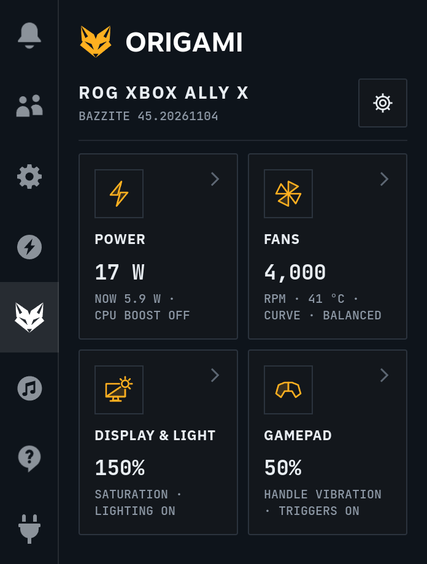
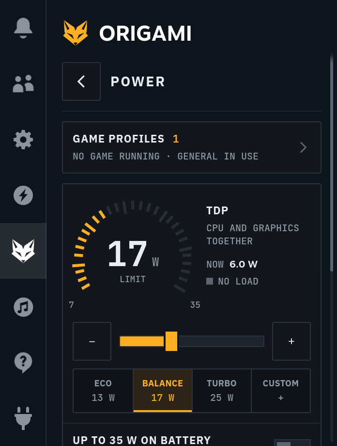
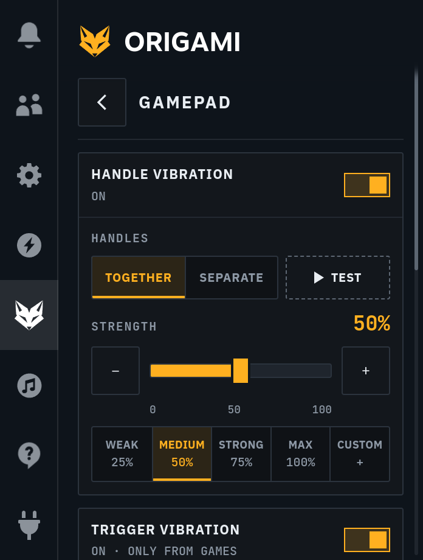
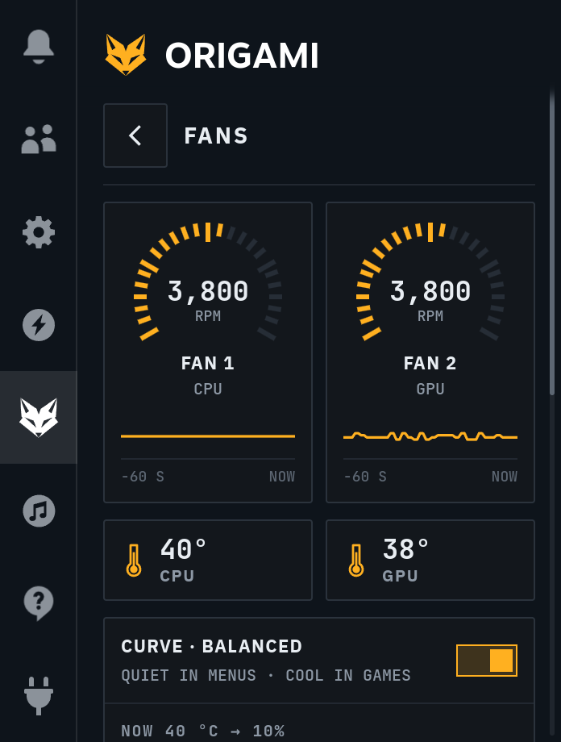
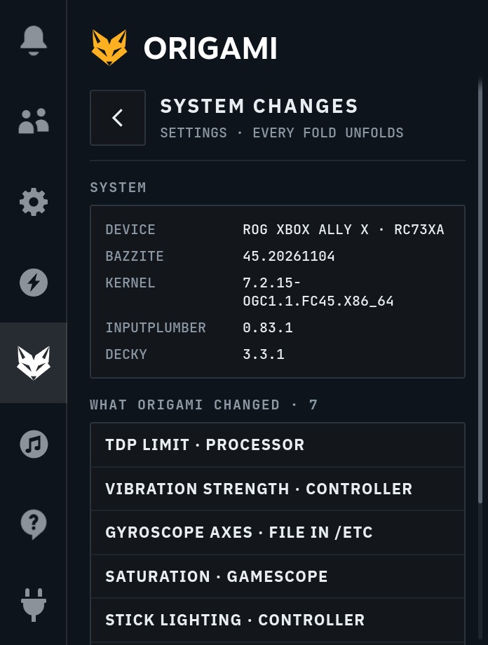

<!-- SPDX-FileCopyrightText: 2026 Alexander Derevyanko (lexdrev) -->
<!-- SPDX-License-Identifier: GPL-3.0-or-later -->

# ORIGAMI

  

  
  

<b>English</b> · <a href="README.ru.md">Русский</a>

ORIGAMI is a [Decky Loader](https://github.com/SteamDeckHomebrew/decky-loader) plugin for the ROG Xbox Ally X on
Bazzite and the ROG Ally on SteamOS. It puts power, fans, display, stick lighting, gamepad and speaker sound
settings in one place and fixes the problems these consoles have on Linux today.

> ORIGAMI is an independent project, not affiliated with ASUS, Microsoft, Valve or the Bazzite team.

## Screenshots

  
  
  
  
  

## What it does

This is all of ORIGAMI, as on the ROG Xbox Ally X. On other models it shows only what the console has: see
[Tested on](#tested-on).

- **Power:** TDP from 7 to 35 W with Eco, Balance and Turbo presets, held through sleep, the charger and game
  starts. Power headroom for short bursts, CPU frequency boost, up to 35 W on battery when you allow it, and
  profiles for single games.
- **Fans:** one curve for both fans: Quiet, Balanced, Strong or your own points. From 80 °C the fans run at
  least at 50%, at 100 °C always at 100%.
- **Display & Light:** screen saturation from 0 to 200% for games and Steam; stick lighting with colours,
  breathing, rainbow and spiral, brightness and a colour of your own.
- **Gamepad:** handle vibration strength, trigger vibration from games, the gyro fix, QAM assist, the Bazzite
  menu fix and actions for the Armoury Crate button, on a short and a long press.
- **Sound:** louder speakers with no crackle, at +4 or +6 dB, protected by the limits ASUS set for each model;
  wider stereo and clearer dialogue. Each game can have its own sound settings. It works on the built-in
  speakers and pauses while headphones are plugged in.
- **Quick access tab:** the fox in Steam's quick access column at the place you choose, or ORIGAMI only inside the
  Decky tab.
- **Updates:** a newer release from GitHub on a press or once a day, what it brings in What's new, and the update
  itself through Decky in one press.

## What it fixes

| On Bazzite 45 | ORIGAMI |
|---|---|
| The TDP drops after sleep and game starts; Steam's slider works only in the Performance profile | Holds the TDP you set and writes it again after sleep, the charger, profile changes and game starts |
| The CPU frequency cap slips after the charger or the profile changes | Programs the cap again and watches the cores |
| After sleep, the CPU boost does not raise the frequency | Lets the boost lift the cores again |
| Handle vibration strength cannot be set and resets after sleep | Strength from 0 to 100%, set again after sleep |
| The trigger motors are silent | Trigger vibration from the games' rumble |
| The gyro's horizontal axis is inverted | Corrected axes for InputPlumber |
| The factory fan curve stops at 78% even at 94 °C | Your own curve, with the safe minimum above |
| The system lights the sticks only in blue, and they go dark after sleep | Any colour and effect, back after sleep and reboot |
| In games, Steam misses up to half of the Library button presses | QAM assist opens the menu on every press |
| Bazzite's own menu, opened by holding Library, turns invisible after its first use: you hear it and it takes over the controls | Makes the menu show up every time |
| The Armoury Crate button does nothing | Actions on a short and a long press: ORIGAMI, screenshot, keyboard, magnifier, close the game and more |
| Paste on Steam's on-screen keyboard types a "v" | Pastes the text; works by itself, there is nothing to switch on |
| The speakers sound flat compared with Windows, where ASUS's Dolby driver processes them | Sound processing: louder with no crackle, wider stereo, clearer voices |
| The sound may crackle after sleep until a restart if the console's clock is set to local time, as Windows does | Corrects the clock as soon as the console wakes, so the sound stays clean |

Fixes you have not decided on yet are red in ORIGAMI. Once you switch one on or off yourself, it turns grey.

## Tested on

- **ROG Xbox Ally X** (board RC73XA): Bazzite 45.20261111, kernel 7.3.3-ogc1.1, InputPlumber 0.84.0,
  Decky Loader 3.3.1
- **ROG Ally** (board RC71L): SteamOS 3.9.5, kernel 7.2.7-valve2, InputPlumber 0.78.0, Decky Loader 3.3.1

On the ROG Ally, the system keeps both buttons, so there are no button settings there; saturation goes up to
100%, because SteamOS already shows the richest colours; the TDP scale ends where the firmware does, at 25 W on
battery and 30 W on the charger. The Bazzite menu fix only appears on systems that have that menu.

ORIGAMI also knows the ROG Ally X (RC72LA), the ROG Xbox Ally (RC73YA) and the ROG Xbox Ally X20 (RC74XA), but it
has not been tried on them yet.

The Sound tile is available on all five models, each with the speaker protection ASUS tuned for it, but so far
the sound has only been listened to on the ROG Xbox Ally X.

## Install

You need [Decky Loader](https://github.com/SteamDeckHomebrew/decky-loader#-installation) 3.3.0 or newer: older
versions run plugins on Python 3.11, and ORIGAMI does not start there; it says so in its menu. In Game Mode, open
Decky's settings and switch on **Developer mode**. Then, on the **Developer** page:

- **By link:** in **Install Plugin from URL**, enter
  `github.com/lexdrev/origami/releases/latest/download/ORIGAMI.zip` and choose **Install**.
- **From a file:** download `ORIGAMI.zip` from the [latest release](https://github.com/lexdrev/origami/releases/latest),
  choose **Install Plugin from ZIP File → Browse** and pick it.

Decky warns that its team has not reviewed the plugin; confirm, and open ORIGAMI from the quick access menu.

To update, use the **Updates** card in ORIGAMI's **Settings**: **Check** finds a newer release, and **Update**
hands it to Decky, which asks before it installs it. Switch on **Check for updates · auto**, and ORIGAMI checks once
a day as it opens and marks a newer release on its main screen. Or install it again the same way as above: the
link always leads to the latest release. Your settings stay either way. While Decky swaps the versions, ORIGAMI
stops for a moment and the system gets its own settings back, so update outside a game.

## Undo everything

**Settings → System changes** lists what ORIGAMI has changed. **Restore everything** brings back the factory
values, removes ORIGAMI's files and switches its fixes and the sound processing off; Steam sets the TDP again.
Removing the plugin in Decky does the same first.

While the gyro fix is on, ORIGAMI keeps one file outside its folders:
`/etc/inputplumber/devices.d/50-rog_xbox_ally.yaml`.

If another plugin already controls the power, the fans, the lighting, the saturation, the vibration or the sound,
ORIGAMI leaves that part alone and shows which plugin has it. The same goes for any other app that processes the
speakers' sound.

## Privacy

ORIGAMI goes online only for updates: when you choose **Check** in its settings, or once a day if you switch on
the daily check, which is off at first. Each time it asks GitHub once for the latest release. It collects nothing.
It runs as root, because the power, fan and lighting settings need it.

## Feedback

Open an [issue](https://github.com/lexdrev/origami/issues) and add your console, the system and its version (ORIGAMI
shows them in **Settings → System changes**), what you did and the latest log from `~/homebrew/logs/Origami/`.

## Thanks

- The [Decky Loader](https://github.com/SteamDeckHomebrew/decky-loader) team, for the plugin platform
- [Bazzite](https://bazzite.gg), for the system
- [Open Gaming Collective](https://github.com/OpenGamingCollective), for the kernel fixes for the Ally X
- [Linux Studio Plugins](https://lsp-plug.in), for the compressor and the limiter of the speaker filter

## License

ORIGAMI © 2026 Alexander Derevyanko (lexdrev), [GPL-3.0-or-later](LICENSE). The HID-BPF program in `bpf/`, which
runs in the kernel, is GPL-2.0-or-later. The fonts and the library built into the plugin, and the LSP plugins that
come with it, are listed in [THIRD_PARTY_NOTICES.md](THIRD_PARTY_NOTICES.md).
