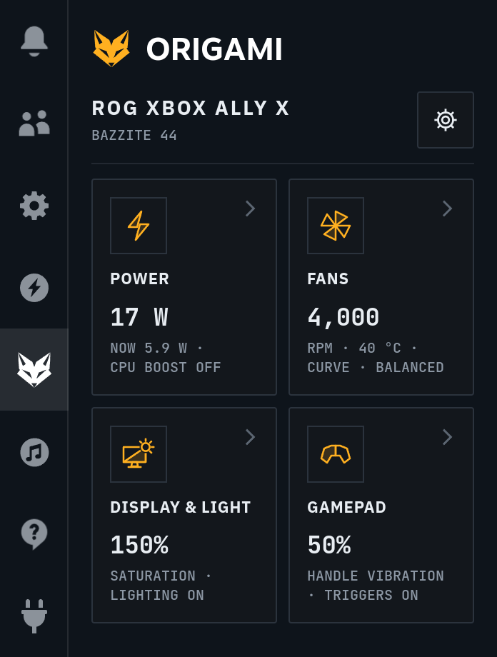
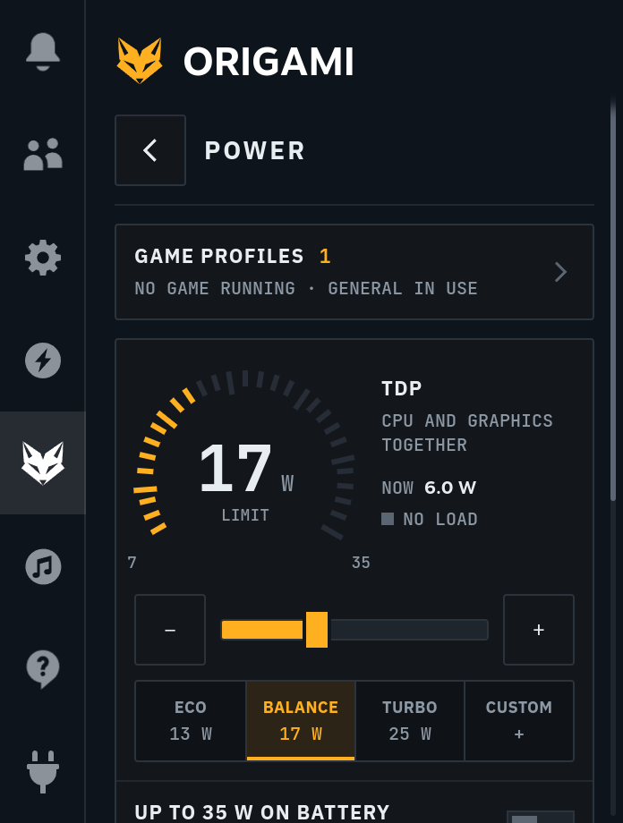
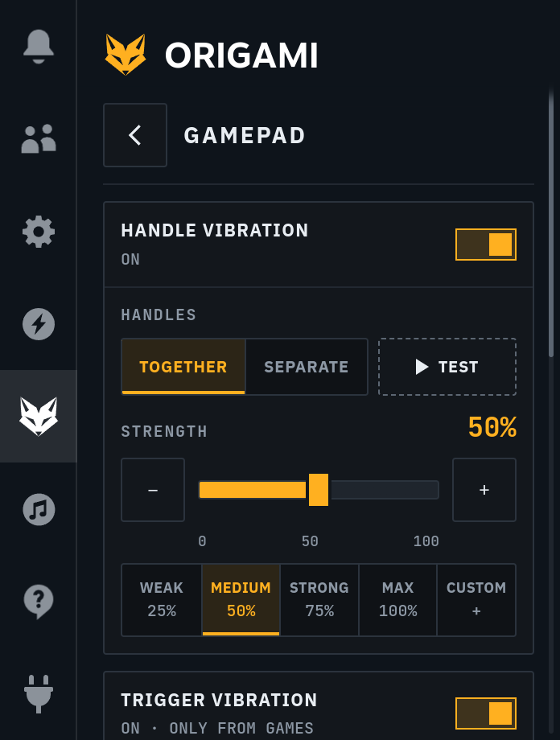
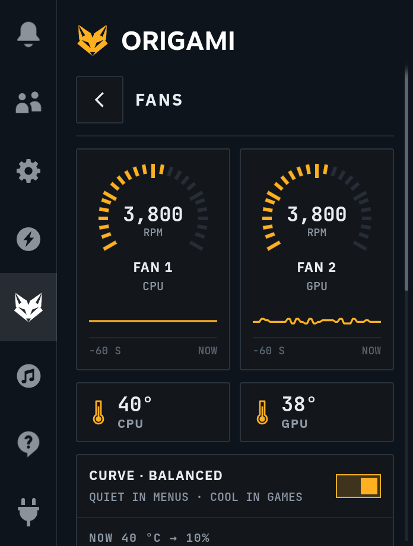
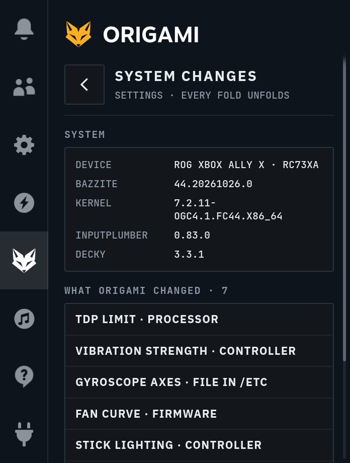

<!-- SPDX-FileCopyrightText: 2026 Alexander Derevyanko (lexdrev) -->
<!-- SPDX-License-Identifier: GPL-3.0-or-later -->

# ORIGAMI

  

  
  

<b>English</b> · <a href="README.ru.md">Русский</a>

ORIGAMI is a [Decky Loader](https://github.com/SteamDeckHomebrew/decky-loader) plugin for the ROG Xbox Ally X on
Bazzite. It puts power, fans, display, stick lighting and gamepad settings in one place and fixes the problems the
console has on Linux today.

> ORIGAMI is an independent project, not affiliated with ASUS, Microsoft, Valve or the Bazzite team.

## Screenshots

  
  
  
  
  

## What it does

- **Power:** TDP from 7 to 35 W with Eco, Balance and Turbo presets, held through sleep, the charger and game
  starts. Power headroom for short bursts, CPU frequency boost, up to 35 W on battery when you allow it, and
  profiles for single games.
- **Fans:** one curve for both fans: Quiet, Balanced, Strong or your own points. From 80 °C the fans run at
  least at 50%, at 100 °C always at 100%.
- **Display & Light:** screen saturation from 0 to 200% for games and Steam; stick lighting with colours,
  breathing, rainbow and spiral, brightness and a colour of your own.
- **Gamepad:** handle vibration strength, trigger vibration from games, the gyro fix, QAM assist and actions for
  the Armoury Crate button, on a short and a long press.
- **Quick access tab:** the fox in Steam's quick access column at the place you choose, or ORIGAMI only inside the
  Decky tab.

## What it fixes

| On Bazzite 44 | ORIGAMI |
|---|---|
| The TDP drops after sleep and game starts; Steam's slider works only in the Performance profile | Holds the TDP you set and writes it again after sleep, the charger, profile changes and game starts |
| The CPU frequency cap slips after the charger or the profile changes | Programs the cap again and watches the cores |
| After sleep, the CPU boost does not raise the frequency | Lets the boost lift the cores again |
| Handle vibration strength cannot be set and resets after sleep | Strength from 0 to 100%, set again after sleep |
| The trigger motors are silent | Trigger vibration from the games' rumble |
| The gyro's horizontal axis is inverted | Corrected axes for InputPlumber |
| The factory fan curve stops at 78% even at 94 °C | Your own curve, with the safe minimum above |
| The system lights the sticks only in blue, and they go dark after sleep | Any colour and effect, back after sleep and reboot |
| In games, Steam misses up to half of the Library button presses | QAM assist opens the menu on every press |
| The Armoury Crate button does nothing | Actions on a short and a long press: ORIGAMI, screenshot, keyboard, magnifier, close the game and more |

Fixes you have not decided on yet are red in ORIGAMI. Once you switch one on or off yourself, it turns grey.

## Tested on

- ROG Xbox Ally X (board RC73XA)
- Bazzite 44.20261026, kernel 7.2.11-ogc4.1, InputPlumber 0.83.0, Decky Loader 3.3.1

ORIGAMI also knows the ROG Xbox Ally X20 (board RC74XA), but it has not been tried on one yet.

## Install

You need [Decky Loader](https://github.com/SteamDeckHomebrew/decky-loader#-installation). In Game Mode, open
Decky's settings and switch on **Developer mode**. Then, on the **Developer** page:

- **By link:** in **Install Plugin from URL**, enter
  `github.com/lexdrev/origami/releases/latest/download/ORIGAMI.zip` and choose **Install**.
- **From a file:** download `ORIGAMI.zip` from the [latest release](https://github.com/lexdrev/origami/releases/latest),
  choose **Install Plugin from ZIP File → Browse** and pick it.

Decky warns that its team has not reviewed the plugin; confirm, and open ORIGAMI from the quick access menu.

To update, install it again the same way: the link always leads to the latest release, and your settings stay.
Installing restarts Decky, and Decky reloads Steam's interface, so close your game first.

## Undo everything

**Settings → System changes** lists what ORIGAMI has changed. **Restore everything** brings back the factory
values, removes ORIGAMI's files and switches its fixes off; Steam sets the TDP again. Removing the plugin in Decky
does the same first.

While the gyro fix is on, ORIGAMI keeps one file outside its folders:
`/etc/inputplumber/devices.d/50-rog_xbox_ally.yaml`.

If another plugin already controls the power, the fans, the lighting, the saturation or the vibration, ORIGAMI
leaves that part alone and shows which plugin has it.

## Privacy

ORIGAMI never goes online and collects nothing. It runs as root, because the power, fan and lighting settings
need it.

## Feedback

Open an [issue](https://github.com/lexdrev/origami/issues) and add your console, the Bazzite version (ORIGAMI shows
it in **Settings → System changes**), what you did and the latest log from `~/homebrew/logs/Origami/`.

## Thanks

- The [Decky Loader](https://github.com/SteamDeckHomebrew/decky-loader) team, for the plugin platform
- [Bazzite](https://bazzite.gg), for the system
- [Open Gaming Collective](https://github.com/OpenGamingCollective), for the kernel fixes for the Ally X

## License

ORIGAMI © 2026 Alexander Derevyanko (lexdrev), [GPL-3.0-or-later](LICENSE). The HID-BPF program in `bpf/`, which
runs in the kernel, is GPL-2.0-or-later. The fonts and the library built into the plugin are listed in
[THIRD_PARTY_NOTICES.md](THIRD_PARTY_NOTICES.md).
