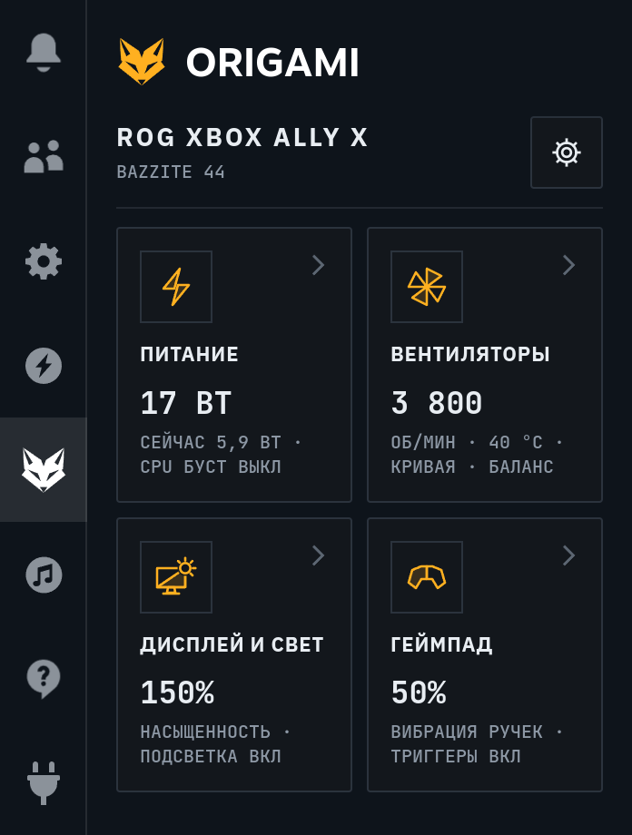
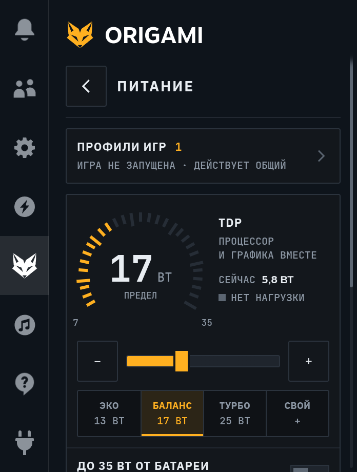
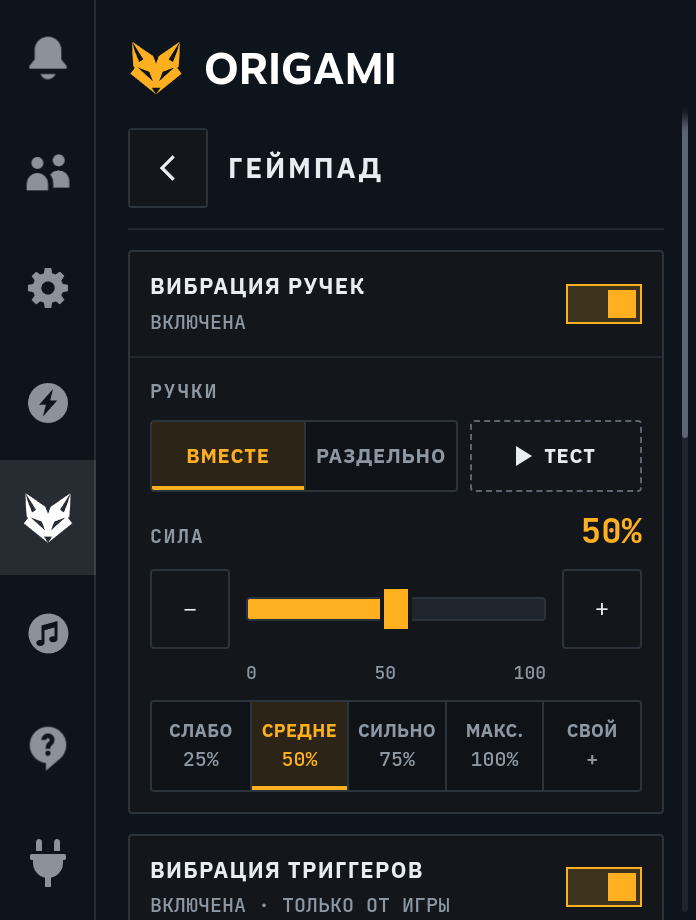
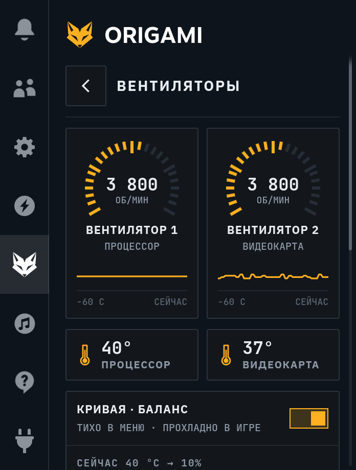
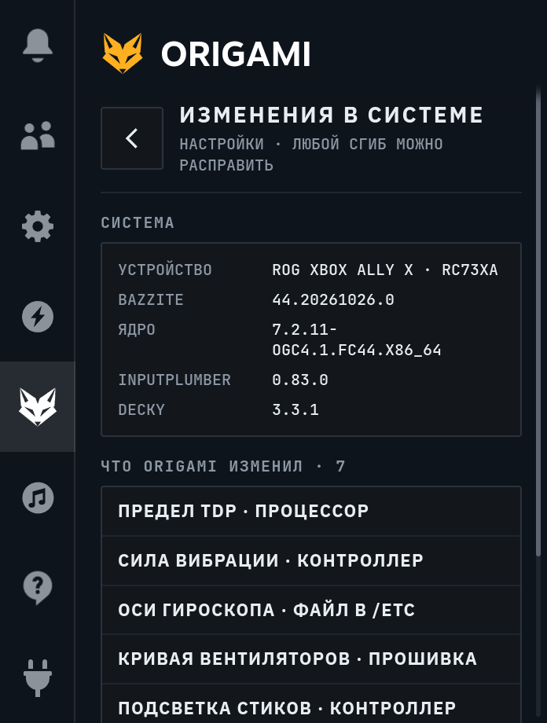

<!-- SPDX-FileCopyrightText: 2026 Alexander Derevyanko (lexdrev) -->
<!-- SPDX-License-Identifier: GPL-3.0-or-later -->

# ORIGAMI

  

  
  

<a href="README.md">English</a> · <b>Русский</b>

ORIGAMI — плагин для [Decky Loader](https://github.com/SteamDeckHomebrew/decky-loader) на ROG Xbox Ally X с Bazzite.
Он собирает в одном месте настройки питания, вентиляторов, экрана, подсветки стиков и геймпада и исправляет
проблемы, которые есть у консоли на Linux сейчас.

> ORIGAMI — независимый проект, он не связан с ASUS, Microsoft, Valve и командой Bazzite.

## Снимки экрана

  
  
  
  
  

## Что умеет

- **Питание:** TDP от 7 до 35 Вт с режимами «Эко», «Баланс» и «Турбо»; держится после сна, зарядки и запуска игр.
  Запас мощности на короткие всплески, буст частоты CPU, до 35 Вт от батареи, если разрешить, и профили для
  отдельных игр.
- **Вентиляторы:** одна кривая на оба: «Тихая», «Баланс», «Мощная» или свои точки. С 80 °C вентиляторы крутятся
  не меньше чем на 50%, при 100 °C — всегда на 100%.
- **Дисплей и свет:** насыщенность экрана от 0 до 200% в играх и в Steam; подсветка стиков: цвета, дыхание, радуга
  и спираль, яркость и свой цвет.
- **Геймпад:** сила вибрации ручек, вибрация триггеров от игр, исправление гироскопа, подстраховка QAM и действия
  для кнопки Armoury Crate на короткое и долгое нажатие.
- **Вкладка в быстром меню:** лиса в колонке быстрого меню Steam на выбранном месте или ORIGAMI только внутри
  вкладки Decky.

## Что исправляет

| В Bazzite 44 | ORIGAMI |
|---|---|
| TDP слетает после сна и запуска игр; ползунок Steam работает только в профиле «Производительность» | Держит заданный TDP и записывает его заново после сна, зарядки, смены профиля и запуска игр |
| Предел частоты CPU слетает после зарядки и смены профиля | Заново программирует предел и следит за ядрами |
| После сна буст CPU не поднимает частоту | Буст снова поднимает частоту ядер |
| Силу вибрации ручек не настроить, после сна она сбрасывается | Сила от 0 до 100%, возвращается после сна |
| Моторы триггеров молчат | Вибрация триггеров от вибрации игр |
| У гироскопа инвертирована горизонтальная ось | Исправленные оси для InputPlumber |
| Заводская кривая вентиляторов не выше 78% даже при 94 °C | Своя кривая с безопасным минимумом выше |
| Система подсвечивает стики только синим, после сна подсветка гаснет | Любой цвет и эффект, возвращаются после сна и перезагрузки |
| В играх Steam теряет до половины нажатий кнопки Library | Подстраховка QAM открывает меню с каждого нажатия |
| Кнопка Armoury Crate ничего не делает | Действия на короткое и долгое нажатие: ORIGAMI, скриншот, клавиатура, лупа, закрыть игру и другие |

Исправления, о которых вы ещё не решили, в ORIGAMI красные. Как только вы сами включите или выключите
исправление, оно станет серым.

## На чём проверено

- ROG Xbox Ally X (плата RC73XA)
- Bazzite 44.20261026, ядро 7.2.11-ogc4.1, InputPlumber 0.83.0, Decky Loader 3.3.1

ORIGAMI знает и ROG Xbox Ally X20 (плата RC74XA), но на ней его ещё не проверяли, как и на SteamOS.

## Установка

Нужен [Decky Loader](https://github.com/SteamDeckHomebrew/decky-loader#-installation). В игровом режиме откройте
настройки Decky и включите **Режим разработчика**. Затем на странице **Разработчик**:

- **По ссылке:** в **Установить плагин из URL** введите
  `github.com/lexdrev/origami/releases/latest/download/ORIGAMI.zip` и нажмите **Установить**.
- **Из файла:** скачайте `ORIGAMI.zip` из [последнего выпуска](https://github.com/lexdrev/origami/releases/latest),
  выберите **Установить плагин из ZIP файла → Обзор** и укажите файл.

Decky предупредит, что его команда этот плагин не проверяла, — подтвердите и откройте ORIGAMI в быстром меню.

Обновление — так же: ссылка всегда ведёт на последний выпуск, настройки сохраняются. Установка перезапускает
Decky, а Decky перезагружает интерфейс Steam, поэтому сначала закройте игру.

## Как всё вернуть

**Настройки → Изменения в системе** показывают, что ORIGAMI изменил. **Вернуть всё как было** возвращает заводские
значения, удаляет файлы ORIGAMI и выключает его исправления; TDP снова задаёт Steam. Удаление плагина в Decky
сначала делает то же самое.

Пока включено исправление гироскопа, вне своих папок ORIGAMI держит один файл:
`/etc/inputplumber/devices.d/50-rog_xbox_ally.yaml`.

Если питанием, вентиляторами, подсветкой, насыщенностью или вибрацией уже управляет другой плагин, ORIGAMI эту
часть не трогает и показывает, какой плагин ею управляет.

## Приватность

ORIGAMI не выходит в сеть и ничего не собирает. Он работает от root: без этого не изменить настройки питания,
вентиляторов и подсветки.

## Обратная связь

Создайте [issue](https://github.com/lexdrev/origami/issues): консоль, система и её версия (ORIGAMI показывает их в
**Настройки → Изменения в системе**), что вы делали, и последний журнал из `~/homebrew/logs/Origami/`.

## Благодарности

- Команде [Decky Loader](https://github.com/SteamDeckHomebrew/decky-loader) — за платформу для плагинов
- [Bazzite](https://bazzite.gg) — за систему
- [Open Gaming Collective](https://github.com/OpenGamingCollective) — за исправления ядра для Ally X

## Лицензия

ORIGAMI © 2026 Alexander Derevyanko (lexdrev), [GPL-3.0-or-later](LICENSE). Программа HID-BPF в `bpf/`, которая
работает в ядре, — GPL-2.0-or-later. Шрифты и библиотека, встроенные в плагин, перечислены в
[THIRD_PARTY_NOTICES.md](THIRD_PARTY_NOTICES.md).
